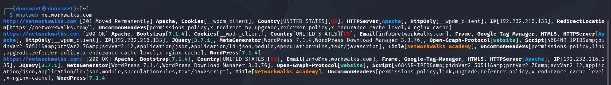
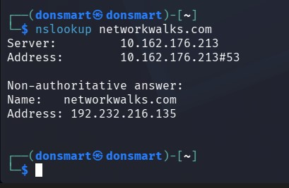
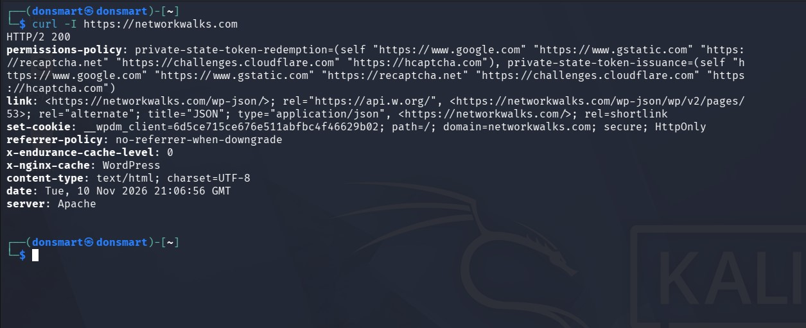
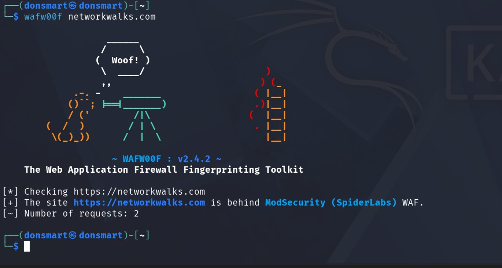
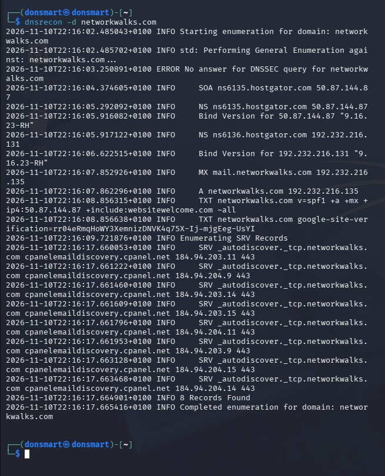
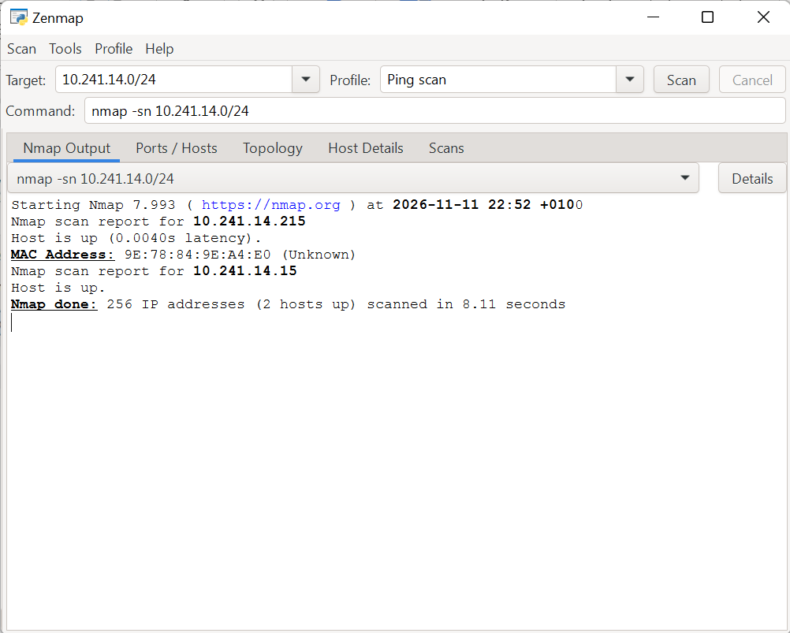
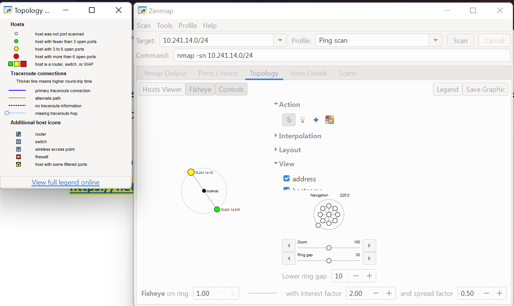

# 🛡️ PENETRATION TESTING REPORT
## FOOTPRINTING & NETWORK SCANNING PHASES

**Networkwalks Cybersecurity Programme | Week 02**

---

## 👨‍💻 Author Information

- **Name:** Akanbi Temitope Benjamen (DON SMART)
- **Programme:** Cybersecurity & Ethical Hacking
- **Batch:** B084
- **Training Institution:** Networkwalks
- **Week:** 02
- **Date:** 10 November 2026

---

## 📌 Project Overview

This repository documents my Week 2 practical activities during the Networkwalks Cybersecurity and Ethical Hacking programme.

The exercises focused on two major areas of cybersecurity:

1. **Footprinting and Reconnaissance:** Gathering publicly available information about a domain using different Kali Linux tools.
2. **Network Scanning and Discovery:** Identifying active devices and understanding network structure using Zenmap.

The practical sessions provided hands-on experience with information gathering, website technology identification, DNS enumeration, HTTP header inspection, firewall identification, and local network discovery.

---

## 🎯 Objectives

The major objectives of this practical were to:

- Understand the fundamentals of footprinting and reconnaissance.
- Gather domain registration information using WHOIS.
- Identify website technologies using WhatWeb.
- Resolve domain names using Nslookup.
- Examine HTTP response headers using Curl.
- Identify Web Application Firewall technologies using Wafw00f.
- Enumerate DNS records using DNSRecon.
- Discover active network devices using Zenmap.
- Understand IP and MAC address identification.
- Generate and document network topology.

---

## 🛠️ Tools and Technologies Used

| Tool | Purpose |
|---|---|
| Kali Linux | Operating system for cybersecurity practicals |
| WHOIS | Domain registration information gathering |
| WhatWeb | Website technology identification |
| Nslookup | Domain name and IP address resolution |
| Curl | HTTP response header inspection |
| Wafw00f | Web Application Firewall identification |
| DNSRecon | DNS record enumeration |
| Zenmap | Network scanning and host discovery |
| Windows CMD | Local IP and network configuration |

---

## 🔍 Activities Performed

### 1. Footprinting and Reconnaissance

I conducted reconnaissance on `networkwalks.com` using six Kali Linux tools.

The activities included:

- **WHOIS:** Retrieved publicly available domain registration details and name server information.
- **WhatWeb:** Identified website technologies, including WordPress and WordPress Download Manager.
- **Nslookup:** Resolved the target domain to its associated IP address.
- **Curl:** Examined HTTP response headers and identified the WordPress REST API endpoint.
- **Wafw00f:** Identified ModSecurity (SpiderLabs) as the Web Application Firewall technology.
- **DNSRecon:** Gathered DNS information, including name servers, mail servers, SPF/TXT records, and service records.

### 2. Network Scanning with Zenmap

The second practical focused on local network discovery using Zenmap.

Activities covered:

- Identifying local IP configuration using Windows CMD.
- Determining the local network subnet.
- Performing a Ping Scan to discover active hosts.
- Examining IP and MAC address information.
- Viewing network topology.
- Exporting the network topology as a PDF document.

**Note:** Any sample IP addresses provided in the practical instructions are not presented as verified results from my personal network scan.

---

## 📊 Risk Analysis and Impact

The exercises highlighted several potential security observations:

| # | Finding | Risk Level |
|---|---|---|
| 1 | Website technology information exposed | Medium |
| 2 | Publicly identifiable server IP address | Low |
| 3 | Web server information exposed | Low |
| 4 | Web Application Firewall identified | Low |
| 5 | DNS infrastructure details exposed | Medium |
| 6 | Multiple active devices detected on local network | Medium |

These observations are not confirmed vulnerabilities. Further authorized security assessments would be required to establish whether they represent actual security weaknesses.

---

## 🔐 Security Recommendations

Based on the practical findings, the following measures are recommended:

1. Review publicly exposed website technology information.
2. Keep CMS platforms, plugins, and web components updated.
3. Properly configure HTTP response headers.
4. Conduct regular DNS record reviews.
5. Maintain and monitor Web Application Firewall configurations.
6. Perform periodic authorized network discovery.
7. Investigate unidentified network devices.
8. Maintain updated network documentation.
9. Ensure appropriate authorization before conducting security assessments.

---

## 📸 Evidence and Screenshots

Screenshots and supporting evidence from the practical activities are organized in the `Screenshots/` directory.

The evidence covers the commands executed, tool outputs, network discovery activities, and other relevant observations.

---

## 📄 Full Practical Report

The complete Week 2 practical report is available below:

[Download Week 2 Penetration Testing Report](Report/Week-2-Penetration-Testing-Report.pdf)

## 📸 Practical Evidence

Screenshots from the practical activities:

### Footprinting and Reconnaissance

### Network Scanning

---

## 📚 Learning Outcomes

Through these practical exercises, I gained experience in:

- Understanding footprinting and reconnaissance techniques.
- Using different Kali Linux tools for information gathering.
- Identifying website technologies and DNS configurations.
- Understanding HTTP response headers.
- Recognizing Web Application Firewall technologies.
- Discovering active devices on a local network.
- Understanding network topology.
- Analyzing potential security risks.
- Preparing cybersecurity reports and documenting technical findings.

---

## ⚖️ Disclaimer

All activities documented in this repository were conducted for educational and research purposes on personally owned systems or systems for which appropriate written authorization was obtained.

The information provided is intended for learning and defensive security awareness only. It must not be used for unauthorized access, disruption, or unlawful activities. The author is responsible for ensuring that all testing remains within an approved scope and complies with applicable laws.

---

## 👤 Author

Akanbi Temitope Benjamen

Cybersecurity Professional B084

**LinkedIn:** [Connect with me](https://www.linkedin.com/in/temitope-akanbi-749363442/)

---

⭐ *Learning. Practicing. Documenting. Growing in Cybersecurity.*

**NETWORKWALKS | CYBERSECURITY PROGRAMME | WEEK 02**
